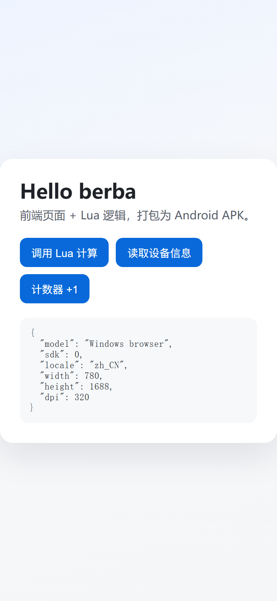
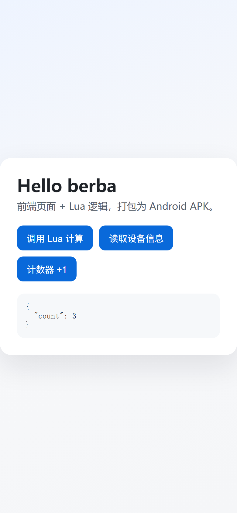

<h1 align="center">berba</h1>

<p align="center">把网页装进 APK，把灵感留在掌心。</p>

<p align="center">
  <a href="https://github.com/anccnuer/berba/actions/workflows/ci.yml"></a>
  <a href="https://github.com/anccnuer/berba/releases"></a>
  <a href="https://go.dev"></a>
  <a href="#限制"></a>
  <a href="#从源码构建"></a>
  <a href="#设计思路"></a>
  <a href="#小剧场"></a>
</p>

berba 是一个轻量的 Android 应用构建器：用 HTML/CSS/JS 写界面，用 Lua 写逻辑，一条命令产出可安装的 APK。终端用户不需要 JDK、Android SDK 或 Android Studio——解压发行包即可开始。

## 为什么是 berba

- **把 Web 装进口袋**：WebView 承载 `www/` 页面，创意不必止步于浏览器标签页。
- **Lua 做胶水**：生命周期、网络、存储、文件、权限等能力以白名单 API 暴露，边界清晰、包体克制。
- **一条命令出包**：自带 Android shell 与 aapt2，不依赖 Gradle/AGP；同一密钥与环境下构建可复现，发布产物附带 SHA-256。
- **开发不重编译**：`berba dev` 在浏览器里直接跑页面和 Lua，改完刷新即可看到效果。
- **纯 Go 打包**：零第三方 Go 依赖；APK 合并、对齐与 v2 签名均由 Go 实现。

## 快速开始

从 [Releases](https://github.com/anccnuer/berba/releases) 下载对应平台的发行包并解压，然后：

```bat
berba.exe doctor
```

确认工具链完整后，创建项目并启动开发服务器：

```bat
berba.exe init myapp --package com.example.myapp
cd myapp
..\berba.exe dev --open
```

`dev` 会用本地 HTTP 服务提供 `www/`，并在浏览器内通过 [fengari](https://github.com/fengari-lua/fengari) 真实执行 `lua/main.lua`——桥方法、事件和 `require` 都能直接调试，改完页面刷新即可。需要伪造设备专属能力时，在 `dev/mock.js` 里写 mock，优先级高于 Lua。

准备上机时构建并安装：

```bat
..\berba.exe build
..\berba.exe install
```

产物位于 `dist\<package>-<versionName>.apk`。Linux 发行包中的可执行文件名为 `berba`，把命令里的 `berba.exe` 与反斜杠相应替换即可。

> [!IMPORTANT]
> 首次构建会生成签名密钥 `.berba\keys\release.pem`。它是应用的身份，**请离线备份**；丢失后无法覆盖升级已安装的应用。

## 看一眼

`examples/hello` 展示了 JS↔Lua 桥、设备信息与本地计数：

<p align="center">
  
  
  
</p>

## 示例

| 示例 | 内容 |
| --- | --- |
| [`examples/hello`](examples/hello) | 最小可运行项目：页面调用 Lua、Lua 回调页面、设备信息、持久化计数 |
| [`examples/led-banner`](examples/led-banner) | 演唱会应援横幅：竖屏调字号/颜色/荧光，横屏全屏滚动，设置自动保存 |

```bat
cd examples\led-banner
..\..\dist\windows-amd64\berba.exe build
```

## 命令一览

| 命令 | 作用 |
| --- | --- |
| `berba init [目录]` | 创建项目脚手架（`--name`、`--package`、`--force`） |
| `berba build [目录]` | 构建 APK（`--debug`、`--out`、`--config`、`--key`） |
| `berba dev [目录]` | 浏览器内开发：静态服务 + Lua 运行时 + 可选 mock |
| `berba watch [目录]` | 文件变更自动重建，可配合 `--install` 上机调试 |
| `berba install [apk]` | 通过 adb 安装（`--device`、`--adb`、`--apk`） |
| `berba keygen` | 生成签名密钥（旧密钥会先备份） |
| `berba doctor` | 体检：工具链、payload、aapt2/android.jar/dex 哈希 |
| `berba release` | 打包发行目录，生成 `versions.json`、zip 与 SHA-256 |
| `berba version` | 显示版本 |

完整参数与故障排查见 [docs/build.md](docs/build.md)。发行包默认以可执行文件所在目录为家，可用 `--home` 或 `BERBA_HOME` 覆盖。

## 项目结构

```
myapp/
  app.json       应用配置：包名、版本、权限、入口、深链
  icon.png       可选图标，建议 512x512
  www/           页面与静态资源
  lua/           Lua 逻辑，入口默认 main.lua
  dev/mock.js    可选，berba dev 的桥 mock（不会进入 APK）
  AGENTS.md      AI Agent 开发指南（能力边界与 API）
  .berba/        构建中间文件与签名密钥（不要提交）
  dist/          构建产物
```

`app.json` 使用严格解析，未知字段（包括拼写错误）会直接让构建失败——早点报错，总比装到手机上才发现好。字段说明见 [docs/config.md](docs/config.md)。

## 设计思路

berba 不做“另一个 Android 构建系统”，而是把常见的小型应用形态收敛成一条固定流水线：

1. **配置即真相**：`app.json` 决定清单、图标、权限与入口，拒绝隐式魔法。
2. **壳与业务分离**：固定的 Android shell 负责 WebView、LuaJ 与系统能力；页面和 Lua 作为资源随包携带。
3. **工具链自带**：发行包内置 shell、aapt2 与 android.jar，构建机只需一个可执行文件。
4. **产物可验证**：每次构建重新分配资源 ID、合并对齐、完成 v2 签名，并在 CI 中逐字节校验可复现性。

`berba dev` 复用同一套页面资源，但把 Lua 搬到浏览器里执行，因此“开发时看到的样子”与“装到手机上的样子”尽量接近，同时不牺牲调试速度。

## 开发体验

```bat
berba dev --open          :: 浏览器内跑页面 + Lua，桥调用直达 Lua
berba watch --install     :: 保存即重建，并自动安装到已连接设备
```

- 桥调用顺序：`dev/mock.js` → 浏览器 Lua → 报错提示。设备专属能力（如分享、方向锁定）可用 mock 精确伪造。
- 浏览器运行时补齐了 `store`、`file`、`http`、`permission`、`ui`、`device`、`json` 等 API；全屏、剪贴板、Wake Lock 等受浏览器限制的行为会降级并给出提示。
- 已知差异（Lua 5.3 vs 设备 LuaJ 5.2、CORS、返回键 `__berbaDev.back()` 等）整理在 [docs/build.md](docs/build.md#浏览器-lua-运行时的已知差异)。

> [!WARNING]
> `berba dev` 默认只监听 `127.0.0.1`。使用 `--host 0.0.0.0` 会把项目源码与 Lua 执行能力暴露到局域网，请只在可信网络中这样做。

## 发行包

```
berba.exe
payload/classes.dex      Android shell（含 LuaJ 3.0.1）
tools/aapt2.exe
tools/android.jar        platform 35
tools/versions.json      版本与 aapt2/android.jar/dex 的 sha256
docs/  NOTICE  README.md
```

`tools/` 与 `payload/` 需与可执行文件同级；`berba doctor` 会校验文件、哈希与 aapt2 可执行性。

## 从源码构建

需要 Go 1.24+。生成完整发行包还需要 JDK 17+ 与 Android SDK（platform 35 + build-tools）：

```powershell
go test ./...
scripts\package-dist.ps1 -Version 0.1.0 -Sdk C:\Android\Sdk
```

Linux/macOS 可使用 shell 版本（仅打包当前平台）：

```bash
VERSION=0.1.0 ANDROID_SDK_ROOT=/path/to/sdk scripts/package-dist.sh
```

Android shell 单独构建：

```powershell
scripts\build-shell.ps1 -Sdk C:\Android\Sdk -Out payload
```

脚本使用 `javac` + `jar` + `d8`，不依赖 Gradle/AGP；LuaJ 固定为 3.0.1，放在 `.tools\luaj\luaj-jse-3.0.1.jar`（或设置 `LUAJ_JAR`）。

## 质量与发布

- CI 覆盖 gofmt、`go vet`、staticcheck、`go test -race`（Linux + Windows）、APK 构建与校验、逐字节可复现性比对。
- 推送 `v*` 标签自动构建并发布 Release，附 Windows/Linux 发行包与 SHA-256。
- 发布前人工验收清单见 [docs/testing.md](docs/testing.md)。

## 限制

- 仅支持 ARM 原生库占位（当前 shell 无 `.so`），不支持原生插件热插拔。
- Lua 为 LuaJ 3.0.1（Lua 5.2 语义、无 JIT），定位为胶水逻辑，不适合重计算。
- 不提供 Google Play/AAB、v1/v3 签名或 iOS 产物。
- 构建机需要能运行 `tools/aapt2.exe`；发行包不包含 adb。

## 文档

| 文档 | 内容 |
| --- | --- |
| [docs/config.md](docs/config.md) | `app.json` 字段与解析规则 |
| [docs/lua-api.md](docs/lua-api.md) | Lua API、桥协议与事件 |
| [docs/build.md](docs/build.md) | 构建流程、`dev`/`watch` 与故障排查 |
| [docs/security.md](docs/security.md) | 安全模型与能力白名单 |
| [docs/testing.md](docs/testing.md) | 测试策略与发布前验收清单 |

## 小剧场

> 页面负责好看，Lua 负责干活，berba 负责把她们装进同一个 APK。
>
> 灵感这种东西，和追番一样——错过了就要等下一集。所以，趁现在。

第三方组件与许可见 [NOTICE](NOTICE)。
